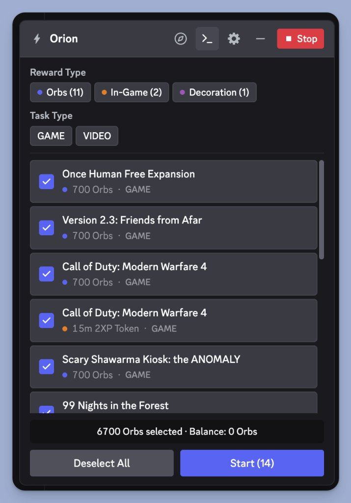

# Discord Quest Completer (Console Script)

[](./LICENSE.md)
[](#)
[](#)

A fast, lightweight, zero-install Discord Quest automation suite running directly inside the Discord desktop client console on **macOS** and **Windows**.

No fake executable binaries (`.exe`). No background spoofers. No disk clutter. Just paste into Discord's developer console and watch all your quests complete automatically.

<p align="center">
  
</p>

---

## ⚡ Features

- **🎮 Parallel Game Quest Execution (`NEW`)**:
  - Run multiple game quests **simultaneously in parallel** (default 15 concurrent, uncapped).
  - Instead of waiting 15 mins for Game A + 15 mins for Game B + 15 mins for Game C (45 mins total), all games run and finish together in a single **15-minute window**!
- **🌐 Supports All 5 Discord Quest Types**:
  - 🎮 **Play Game** (`PLAY_ON_DESKTOP`) – patches Discord's internal `RunningGameStore` with verified Application IDs so Discord dispatches authentic heartbeats.
  - 📺 **Stream Game** (`STREAM_ON_DESKTOP`) – simulates active broadcast stream to friends.
  - 🎬 **Watch Video** (`WATCH_VIDEO`) – sends instant completion progress in ~1 second.
  - 🎤 **Activity Quests** (`PLAY_ACTIVITY`) – simulates participation in voice activities.
  - 🏆 **In-Activity Achievements** (`ACHIEVEMENT_IN_ACTIVITY`) – fulfills milestone criteria automatically.
- **✨ Full Lifecycle Automation**:
  - **Auto-Enroll**: Automatically discovers and accepts all available quests.
  - **Auto-Claim**: Immediately claims in-game items, cosmetics, or Discord Orbs upon completion.
  - **Audio Cue on Completion**: Plays an instant audio chime notification when quests finish (enabled by default).
- **🖥️ Native Interactive UI & Quick Controls**:
  - Renders a clean, responsive modal directly inside Discord with real-time progress bars, individual quest checkboxes, reward filters, and settings toggles.
  - **Live Settings Drawer (⚙️)**: Easily change max concurrency, toggle sound, configure random cycle delays, or toggle auto-enrollment and auto-claim on the fly.
  - **Floating Unhide Pill & Hotkey**: Minimize the UI anytime; restore it with the floating `[⚡ Orion]` pill button or press <kbd>Shift</kbd> + <kbd>.</kbd> (or <kbd>&gt;</kbd>).
  - **Direct Discord Quests Tab Navigation**: Jump straight to Discord's `/quest-home` tab with a single click (🧭 icon) to view or claim completed rewards.
- **🍏 Cross-Platform (macOS & Windows)**:
  - Works identically on macOS (Apple Silicon & Intel) and Windows 10/11.

---

## 🚀 Quick Start Guide

### Step 1: Enable Discord DevTools (One-Time Setup)

DevTools allows you to open the developer console inside Discord.

You can enable it automatically by running the included helper script:
```bash
python enable_devtools.py
```

*Or enable it manually:*
- **Windows**: Add `"DANGEROUS_ENABLE_DEVTOOLS_ONLY_ENABLE_IF_YOU_KNOW_WHAT_YOURE_DOING": true` to `%APPDATA%\discord\settings.json`.
- **macOS**: Add `"DANGEROUS_ENABLE_DEVTOOLS_ONLY_ENABLE_IF_YOU_KNOW_WHAT_YOURE_DOING": true` to `~/Library/Application Support/discord/settings.json`.
*(If you use client extensions like Vencord or BetterDiscord, DevTools is already enabled by default).*

> [!NOTE]
> Make sure to restart Discord completely (<kbd>Cmd</kbd> + <kbd>Q</kbd> on macOS or right-click System Tray → Quit on Windows) after enabling DevTools.

---

### Step 2: Run the Script in Discord

1. Open your **Discord Desktop App**.
2. Open Developer Tools using the keyboard shortcut:
   - **macOS**: <kbd>Cmd</kbd> + <kbd>Option</kbd> + <kbd>I</kbd>
   - **Windows / Linux**: <kbd>Ctrl</kbd> + <kbd>Shift</kbd> + <kbd>I</kbd>
3. Switch to the **Console** tab at the top of the DevTools panel.
4. Copy the entire contents of [`quest_script.js`](./quest_script.js), paste it into the console, and press <kbd>Enter</kbd> (or <kbd>Return</kbd> on Mac).
5. The **Quest Completer** window will appear directly in your Discord app:
   - Select the quests you want to complete.
   - Leave **"Run Game Quests in Parallel (Multi-Game)"** enabled to finish them all at once.
   - Click **Start** and let it run!

---

## 📊 Comparison: In-Client Script vs Legacy `.exe` Spoofers

| Feature | In-Client Console Script (`quest_script.js`) | Legacy External Spoofers |
| :--- | :---: | :---: |
| **macOS Support** | ✅ Native macOS support | ❌ Windows only |
| **Parallel Game Tasks** | ✅ Uncapped (default 15 games simultaneously) | ❌ One game at a time |
| **Video Quest Speed** | ✅ Instant (~1 second) | ❌ Not supported |
| **Unlisted Executable Games (e.g. FC 27)** | ✅ Full support via App ID | ❌ Fails (Discord DB lacks `.exe`) |
| **Activity Quests** | ✅ Full voice activity simulation | ❌ Fails |
| **Disk Clutter** | ✅ Zero files created on Desktop | ❌ Creates copies of `.exe` on Desktop |
| **Auto-Claim Rewards** | ✅ Automatic instant claim | ❌ Manual claim required |

---

## 📁 Repository Structure

```text
├── quest_script.js         # Main Discord console quest completer script
├── enable_devtools.py      # Cross-platform utility to toggle Discord DevTools
├── .agents/                # Operating standards & project architecture context
│   ├── agents.md
│   └── project-context.md
├── CONTRIBUTING.md         # Contribution guidelines & architecture standards
├── README.md               # Documentation & usage guide
└── LICENSE.md              # MIT License
```

---

## ⚖️ License

This project is licensed under the [MIT License](./LICENSE.md).

---

## ⚠️ Disclaimer

This tool interacts with Discord client internals and is provided strictly for educational purposes and protocol research. Use in compliance with applicable terms of service.
